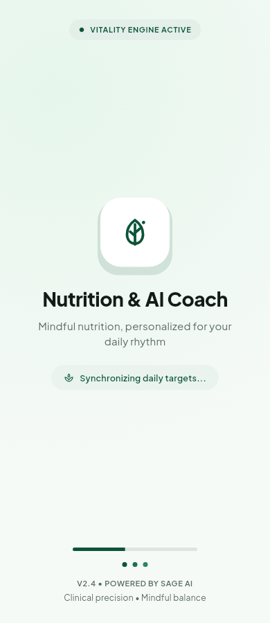
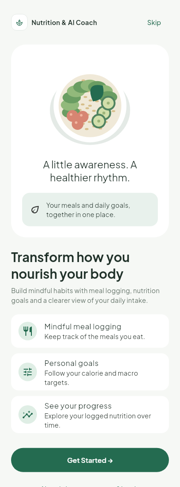
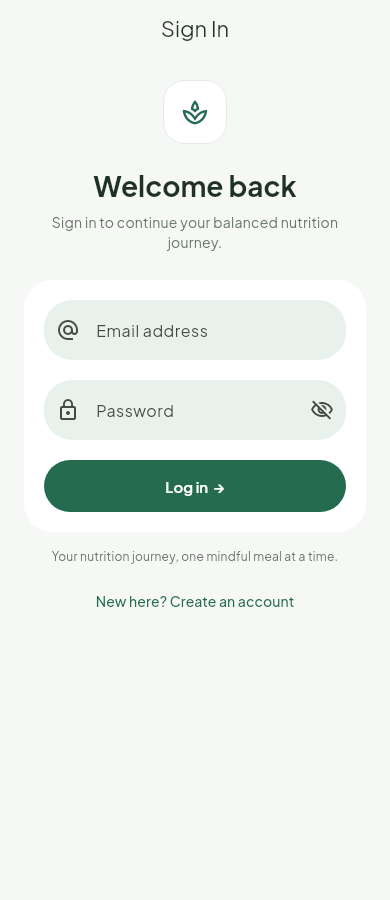
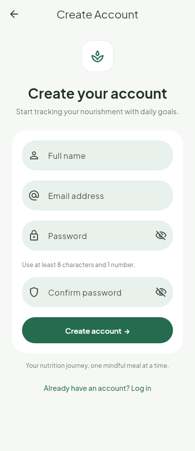
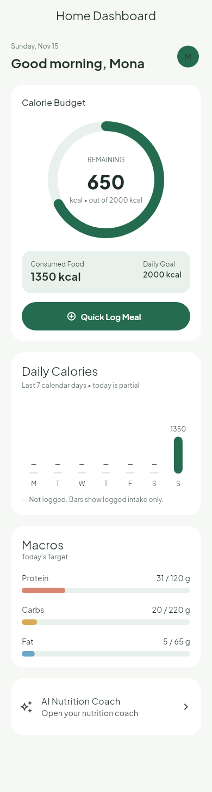

# Nutrition & AI Coach

A responsive Flutter (Material 3) application for mindful daily nutrition tracking, macro monitoring, 7-day calorie trends, and AI-assisted dietary coaching, styled in a calm **soft-health / mint minimalism** palette (`#F5F8F6` background, `#1E6B4B` forest-green primary) with bundled `PlusJakartaSans` typography.

## Product Idea

**Nutrition & AI Coach** helps users stay aware of their daily intake without clutter:

- **Daily Calorie Budget**: Compares consumed food calories against the user's daily target (`Remaining = Goal − Consumed`, or `Over Goal` when exceeded). Exercise calories are intentionally excluded from this calculation.
- **Macronutrient Tracking**: Tracks grams consumed vs. daily targets for **Protein**, **Carbs**, and **Fat**.
- **7-Day Calorie Trend**: Displays a rolling 7-calendar-day bar chart grouped by local calendar date (`YYYY-MM-DD`), clearly separating logged days, unlogged days (`—`), and partial current-day progress.
- **Unified Navigation Shell**: Gives authenticated users quick access to **Home**, **Analytics** (Nutrition Trends & Meal History), **AI Coach**, and **Profile**, anchored around a central **`+` (Add Meal)** action that opens a dedicated full-screen logging flow.

> [!NOTE]
> This repository implements the core application foundation (**Splash, Onboarding, Login / Sign Up, Home Dashboard, App Gate, Main Navigation Shell, Firebase Auth, Hive Preferences, and Firestore User Profiles**). **Add Meal**, **Analytics**, **AI Coach**, and **Profile** are exposed through typed integration boundaries ready for teammates to plug in.

### Screen Previews

Generated via [`tool/render_previews.dart`](tool/render_previews.dart) into `docs/previews/` (`home.png` uses a test fixture stream; the remaining screens reflect the live widget implementations):

| Splash | Onboarding | Login | Sign Up | Home Dashboard |
| :---: | :---: | :---: | :---: | :---: |
|  |  |  |  |  |

---

## Screens & Feature Scope

The app defines **9 route-level screens** (7 functional screens excluding Splash and Onboarding):

| Screen | Status | Bottom Nav? | Purpose | Location |
|---|---|---|---|---|
| **Splash** | Implemented | No | Shown during Firebase/Hive startup and session or profile restoration | [`lib/features/splash`](lib/features/splash/presentation/screens/splash_screen.dart) |
| **Onboarding** | Implemented | No | Single scrollable introduction highlighting core features; completion saved locally in Hive | [`lib/features/onboarding`](lib/features/onboarding/presentation/screens/onboarding_screen.dart) |
| **Login** | Implemented | No | Email/password sign-in with validation, password visibility toggle, and error mapping | [`lib/features/auth`](lib/features/auth/presentation/screens/login_screen.dart) |
| **Sign Up** | Implemented | No | Registration (name, email, password, confirm) + atomic Firestore profile provisioning | [`lib/features/auth`](lib/features/auth/presentation/screens/sign_up_screen.dart) |
| **Home Dashboard** | Implemented | Yes | Personalized greeting, calorie ring, 7-day chart, macro bars, AI Coach shortcut, and quick-log CTA | [`lib/features/home`](lib/features/home/presentation/screens/home_screen.dart) |
| **Analytics** | Teammate slot | Yes | Two internal views (Nutrition Trends & Meal History) plugged into `TeamScreens.analytics` | [`MainShell`](lib/core/navigation/main_shell.dart) |
| **AI Coach** | Teammate slot | Yes | Conversational dietary guidance plugged into `TeamScreens.coach` | [`MainShell`](lib/core/navigation/main_shell.dart) |
| **Profile** | Teammate slot | Yes | User identity, calorie/macro goal editing, and sign-out plugged into `TeamScreens.profile` | [`MainShell`](lib/core/navigation/main_shell.dart) |
| **Add Meal** | Teammate slot | **No** | Standalone full-screen route pushed above the shell from the center `+` button or Home CTA | [`TeamScreens.addMeal`](lib/core/navigation/main_shell.dart) |

---

## Architecture & Data Flow

The codebase follows a **feature-first architecture with `flutter_bloc` (`Cubit`)** and **no Repository Pattern** (no repository classes, use-case wrappers, or service locators). Dependencies flow cleanly via constructor injection:

```text
Screen / Widget  ──▶  Cubit  ──▶  Service  ──▶  Firebase Auth / Cloud Firestore / Hive
       ▲                                                      │
       └────────────── immutable state emissions ─────────────┘
```

### Startup & Navigation Flow

`AppGate` switches root screens declaratively from `AppState` rather than imperatively pushing Login/Home routes, preventing stale history stacks across auth transitions:

```text
main() ─▶ Bootstrap (Firebase.initializeApp + Hive 'preferences' box)
            │
            ▼
       App (AppCubit + AppGate)
            ├── AppStatus.checking / preparingUser ──▶ SplashScreen
            ├── AppStatus.needsOnboarding          ──▶ OnboardingScreen
            ├── AppStatus.unauthenticated          ──▶ LoginScreen ⇄ SignUpScreen (AuthCubit)
            ├── AppStatus.failure                  ──▶ AppErrorView (Retry / Sign out)
            └── AppStatus.authenticated            ──▶ _SessionNavigator [key: ValueKey(uid)]
                                                          ├── HomeCubit(uid)
                                                          └── MainShell (Home | Analytics | [+] | AI Coach | Profile)
                                                                 └── [+] pushes Add Meal above the shell
```

- **Session-scoped navigation**: `_SessionNavigator` is keyed by `ValueKey(state.profile!.uid)`. Signing out or switching accounts immediately disposes the navigator and any pushed routes (such as `Add Meal`), so pressing **Back** can never expose a previous account's screen.
- **Responsive Home layout**: `HomeScreen` renders a single vertical card column on compact screens and switches to a 2-column layout (`maxWidth: 1000`, breakpoint `>= 720 px`) on tablets and desktop/web viewports.

### State Management (Cubits)

| Cubit | Scope | Responsibilities | Source |
|---|---|---|---|
| `AppCubit` | App-wide singleton | Listens once to `AuthService.authStateChanges()`, checks/saves Hive onboarding flag, waits for registration writes, and ensures Firestore profile existence before entering `authenticated` | [`lib/app/cubit/app_cubit.dart`](lib/app/cubit/app_cubit.dart) |
| `AuthCubit` | Unauthenticated auth flow | Coordinates `login` and `register` submissions, blocks duplicate submits, and maps `FirebaseAuthException` codes to readable messages | [`lib/features/auth/presentation/cubit/auth_cubit.dart`](lib/features/auth/presentation/cubit/auth_cubit.dart) |
| `HomeCubit` | Authenticated session | Watches `UserProfileService.watchProfile(uid)` and optional `MealPeriodReader` for the trailing 7 local calendar days, builds `HomeSummary` via `HomeMetricsCalculator`, resets cached inputs on stream failure, and refreshes automatically at local midnight or app resume | [`lib/features/home/presentation/cubit/home_cubit.dart`](lib/features/home/presentation/cubit/home_cubit.dart) |

---

## Project Directory Structure

```text
lib/
├── main.dart                         # App entrypoint: initializes Firebase & Hive, injects services into App
├── app.dart                          # Root MaterialApp, AppCubit provider, and AppGate host
├── firebase_options.dart             # Generated FlutterFire options for Android and Web (nutration-ai-36e01)
├── app/
│   ├── app_gate.dart                 # Declarative root router + session-scoped _SessionNavigator
│   └── cubit/                        # AppCubit and AppState (startup, onboarding, auth & profile gating)
├── core/
│   ├── firebase_bootstrap.dart       # Idempotent Firebase initialization wrapper
│   ├── data/
│   │   ├── models/                   # Shared contracts: UserProfile, NutritionGoals, MealEntry
│   │   └── services/                 # UserProfileService (Firestore CRUD/stream) & MealPeriodReader typedef
│   ├── navigation/                   # MainDestination enum, MainShell bottom bar, TeamScreens & placeholders
│   ├── theme/                        # AppColors palette & Material 3 AppTheme (PlusJakartaSans)
│   ├── utils/                        # Local calendar dayKey helpers, nutrition math, auth error mapping
│   └── widgets/                      # Shared BrandMark and AppErrorView
└── features/
    ├── splash/                       # SplashScreen UI
    ├── onboarding/                   # OnboardingService (Hive) + OnboardingScreen & custom-painted food bowl
    ├── auth/                         # AuthService (FirebaseAuth) + AuthCubit, LoginScreen, SignUpScreen & form widgets
    └── home/                         # HomeMetricsCalculator, HomeSummary, HomeCubit, HomeScreen & dashboard cards

firebase/                             # Local Firestore Security Rules & index config for emulator verification
docs/
├── DEVICE_VERIFICATION.md            # On-device Android verification checklist and status
└── previews/                         # Rendered PNG previews for Splash, Onboarding, Login, Sign Up, and Home
test/                                 # Unit, Cubit, widget, responsive layout, and Hive tests + Firestore rules tests
tool/
├── connect_firebase.dart             # Utility to wire firebase_bootstrap.dart to generated firebase_options.dart
└── render_previews.dart              # Headless widget test that exports screen preview PNGs to docs/previews/
assets/
├── fonts/                            # Bundled PlusJakartaSans.ttf and OFL.txt license
└── icons/app_icon.png                # Launcher icon artwork used by flutter_launcher_icons.yaml
```

*(If present locally, `Agentic/` holds the gitignored specification pack and design mockups.)*

---

## Data Storage & Firestore Schema

### 1. Local Storage (Hive)

- **Box**: `preferences`
- **Key**: `onboarding_completed_v1` (`bool`) — tracks whether the user has dismissed onboarding (`Skip`, `Get Started →`, or `Already have an account? Log in`) or restored an existing signed-in session.

### 2. Firebase Authentication

- **Provider**: Email & Password (`FirebaseAuth`).
- Signup trims the email, preserves password spaces, creates the user, sets `displayName`, and waits for Firestore profile creation before `AppCubit` transitions to `MainShell`. If profile creation fails mid-signup, `AppCubit` offers a retry flow without creating a duplicate Auth account.

### 3. Cloud Firestore

#### User Profile: `/users/{uid}`

Created atomically via a Firestore transaction in `UserProfileService.ensureProfile` (preserving existing goals/identity on subsequent logins).

| Field | Type | Notes & Defaults |
|---|---|---|
| `uid` | `string` | Must match the authenticated user's UID |
| `name` | `string` | `1–80` characters (falls back to `'User'` if blank) |
| `email` | `string` | User's registered email (`<= 254` chars) |
| `photoPath` | `string \| null` | Optional relative Storage path (`users/{uid}/avatar/profile.jpg`) |
| `dailyGoals` | `map` | `{ calories: 2000, proteinG: 120, carbsG: 220, fatG: 65 }` by default |
| `createdAt` | `timestamp` | Server timestamp set on creation (immutable) |
| `updatedAt` | `timestamp` | Server timestamp updated on profile/goal edits |

#### Meals Subcollection: `/users/{uid}/meals/{mealId}`

Expected document contract (owned by the Meals teammate and mapped to `MealEntry`):

| Field | Type | Constraints |
|---|---|---|
| `name` | `string` | `1–200` characters |
| `mealType` | `string` | `'breakfast' \| 'lunch' \| 'dinner' \| 'snack'` |
| `consumedAt` | `timestamp` | Meal consumption timestamp |
| `localDayKey` | `string` | Local calendar date `YYYY-MM-DD` used to group Home's 7-day window |
| `servingGrams` | `number` | `> 0` and `<= 20000` |
| `caloriesKcal` | `number` | `0–50000` |
| `proteinG`, `carbsG`, `fatG` | `number` | `0–10000` |
| `createdAt`, `updatedAt` | `timestamp` | Server timestamps |

---

## Team Integration Guide

`App` exposes two integration parameters so teammate modules can be plugged in at [`lib/main.dart`](lib/main.dart) without editing `HomeCubit`, `AppGate`, or `MainShell`:

1. **`mealReader`** (`MealPeriodReader?`, defined in [`lib/core/data/services/meal_reader.dart`](lib/core/data/services/meal_reader.dart)):
   - Signature: `Stream<List<MealEntry>> Function(String uid, String firstDayKey, String lastDayKey)`
   - Returns meals matching the inclusive `YYYY-MM-DD` range using [`MealEntry`](lib/core/data/models/meal_entry.dart).
   - While `mealReader` is `null`, Home displays a clear **"No meal data connected"** card alongside the user's saved daily calorie goal. Once injected, an empty stream represents genuinely zero logged meals.
2. **`screens`** (`TeamScreens`, defined in [`lib/core/navigation/main_shell.dart`](lib/core/navigation/main_shell.dart)):
   - Accepts `WidgetBuilder?` slots for `analytics`, `coach`, `profile`, and `addMeal` (replacing the default `IntegrationPlaceholder` views).
   - `addMeal` is pushed onto the session-scoped navigator (no bottom navigation bar).
   - The **Profile** screen should use the shared `UserProfileService.updateGoals(uid, goals)`, `UserProfileService.updateName(uid, name)`, and `context.read<AppCubit>().signOut()`.

### Example Wiring

```dart
App(
  auth: authService,
  profiles: profileService,
  onboarding: onboardingService,
  mealReader: mealService.watchMealsForPeriod,
  screens: TeamScreens(
    analytics: (_) => const AnalyticsScreen(),
    coach: (_) => const CoachScreen(),
    profile: (_) => const ProfileScreen(),
    addMeal: (_) => const AddMealScreen(),
  ),
)
```

---

## Getting Started & Firebase Setup

### Prerequisites

- Flutter SDK (`^3.13.7` Dart SDK constraint in [`pubspec.yaml`](pubspec.yaml))
- Node.js + Firebase CLI + Java 21+ (only required for local Firestore Security Rules emulator tests)

### Run the App

```sh
flutter pub get
flutter run -d chrome
flutter run -d <android-device-id>
```

### Firebase Configuration

- **Registered platforms**: Android (`com.example.nutration_ai`) and Web, targeting Firebase project **`nutration-ai-36e01`** (default Firestore database in `nam5`, Email/Password Auth enabled).
- Client configuration lives in [`lib/firebase_options.dart`](lib/firebase_options.dart), [`android/app/google-services.json`](android/app/google-services.json), and [`firebase.json`](firebase.json) (public client identifiers only, no admin credentials).
- Platform notes: Firebase Storage is optional and unconfigured; iOS/macOS scaffolding is absent; Linux desktop Firebase Auth is unsupported.
- To regenerate FlutterFire options:

```sh
flutterfire configure --project=nutration-ai-36e01 --platforms=android,web --android-package-name=com.example.nutration_ai
```

> [!IMPORTANT]
> The deployed Firestore rules on `nutration-ai-36e01` are currently Console test-mode rules (allowing reads/writes until December 15, 2026) and were left unchanged by request. Owner-isolated production rules exist in [`firebase/firestore.rules`](firebase/firestore.rules) and pass local emulator checks, but have **not** been deployed.

---

## Verification & Tooling

### Code Quality, Tests & Builds

```sh
dart format .
flutter pub get
flutter analyze
flutter test
flutter build web
flutter build apk --debug
```

Unit and widget tests in [`test/`](test/) use `mocktail` and `fake_cloud_firestore` to verify `AppCubit` startup/auth ordering, `AuthCubit`/`AuthService` validation and error handling, `UserProfileService` idempotency, `HomeMetricsCalculator` math and calendar boundaries, `HomeCubit` stream failure recovery, Hive persistence, responsive layouts (`320x640`, `390x844`, `1000x900` at `1.4x` text scale), and `MainShell` navigation isolation.

### Local Firestore Rules Emulator Tests

Runs exclusively against the local `demo-nutrition-ai` emulator namespace (requires Java 21+ on `PATH`):

```sh
npm ci --prefix test/firebase_rules
firebase emulators:exec --project demo-nutrition-ai --config firebase.emulators.json --only firestore 'npm test --prefix test/firebase_rules'
```

### Utility Scripts

- **Regenerate screen previews** into `docs/previews/`:
  ```sh
  flutter test tool/render_previews.dart
  ```
- **Regenerate Android & Web launcher icons** from [`assets/icons/app_icon.png`](assets/icons/app_icon.png) via [`flutter_launcher_icons.yaml`](flutter_launcher_icons.yaml):
  ```sh
  dart run flutter_launcher_icons
  ```
- **Approved live Firebase smoke test** (creates two temporary accounts/profiles via the Web client SDK, verifies auth & profile operations, and cleans them up; requires explicit authorization):
  ```sh
  NUTRITION_LIVE_TEST=approved node test/firebase_rules/live_check.mjs
  ```

For full verification results, Android device smoke-test findings, and remaining integration items, see [`IMPLEMENTATION.md`](IMPLEMENTATION.md) and [`docs/DEVICE_VERIFICATION.md`](docs/DEVICE_VERIFICATION.md).
